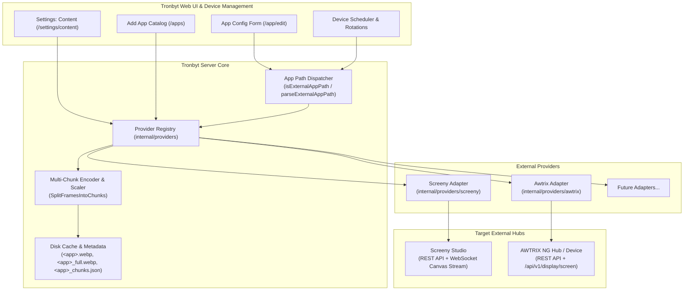
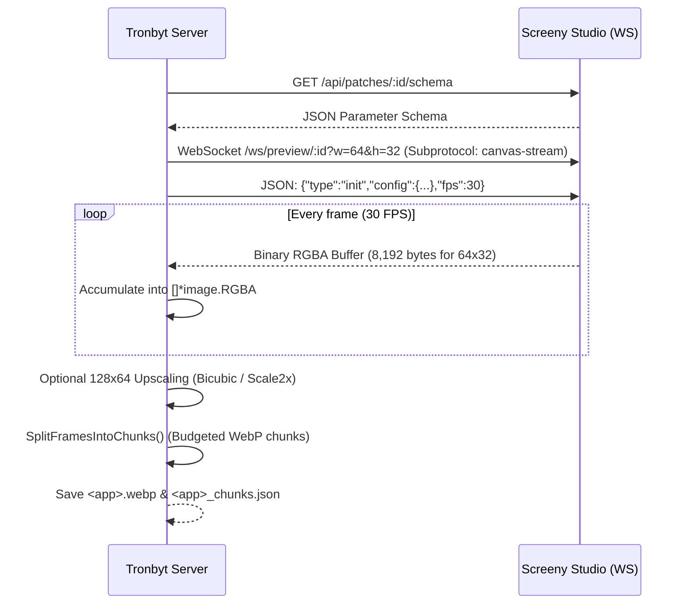
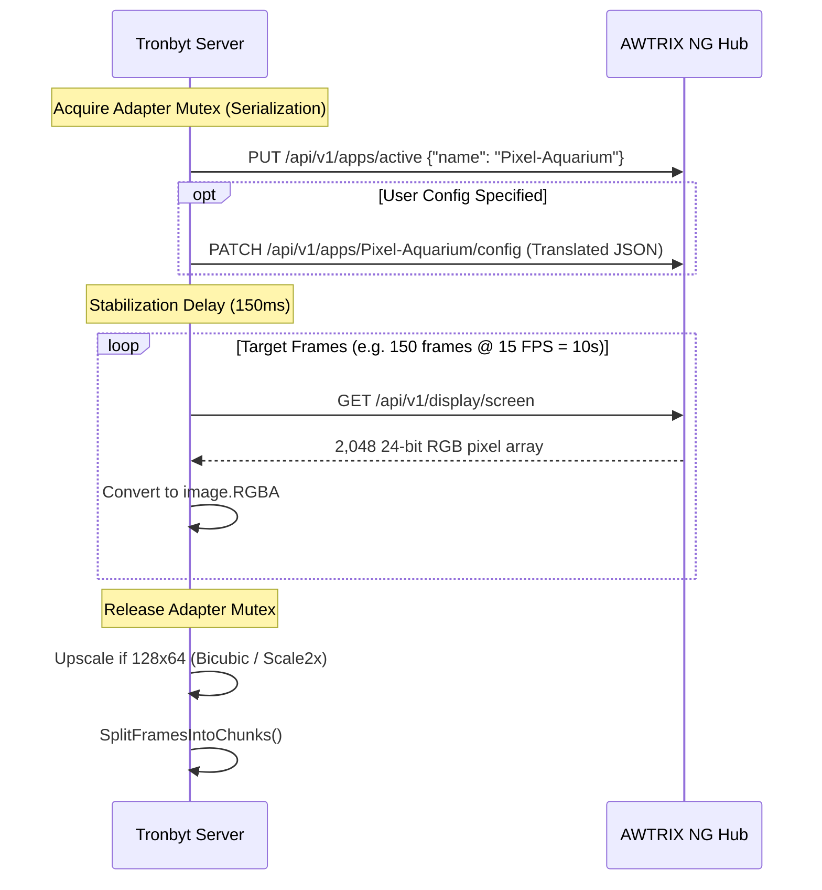
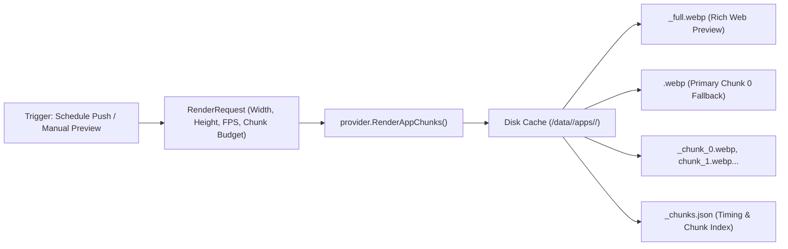

# External App Providers Architecture

This document provides a comprehensive architectural and technical overview of the **External App Providers** subsystem in Tronbyt Server. It details how third-party rendering engines and matrix platforms—such as **Screeny Studio** and **AWTRIX NG**—are integrated into Tronbyt as first-class app providers alongside native Pixlet (Starlark) scripts.

---

## 1. Architectural Motivation

Historically, Tronbyt Server relied exclusively on [Pixlet](https://github.com/tidbyt/pixlet) (Starlark scripts) rendered via native Go bindings. While Pixlet is lightweight and fast for tabular or static layouts, modern smart-display ecosystems have evolved:

* **Screeny Studio**: Web canvas and Node.js-based generative animations, complex physics engines, fluid dynamics (e.g. metaballs), and high-framerate 30–60 FPS procedural graphics.
* **AWTRIX NG**: A widely-adopted ESP32/Linux smart matrix platform with an extensive catalog of builtin apps (clocks, dates, system metrics) and scripted apps (e.g. `Pixel-Aquarium`, `Ghost-Parade`, `Beautiful-Weather`, Berry plugins).
* **Future Platforms**: Home Assistant dashboards, DAKboard widgets, WLED visualizers, and Grafana panels.

The **External App Provider Subsystem** introduces a pluggable, decoupled abstraction layer allowing Tronbyt Server to:
1. **Discover** remote apps, widgets, and patches dynamically over local network APIs.
2. **Translate** proprietary foreign configuration schemas into standard Pixlet JSON configuration schemas rendered identically in the Tronbyt UI.
3. **Capture** high-speed live frame streams (via WebSockets or REST framebuffers).
4. **Encode & Chunk** the captured frames into memory-budgeted animated WebPs compatible with Tidbyt Gen 1, ESP32-S3, Matrix Wide, and Raspberry Pi devices using the [Multi-Chunk Architecture](file:///home/brombomb/dev/tronbyt-server/MULTI_CHUNK.md).
5. **Seamlessly Manage** external apps in the unified Tronbyt UI, device schedules, night modes, and rotation cycles without requiring devices to know where the pixels originated.

---

## 2. High-Level Architecture



---

## 3. Core Interface & Contracts (`internal/providers/provider.go`)

All external app integrations implement the [`ExternalAppProvider`](file:///home/brombomb/dev/tronbyt-server/internal/providers/provider.go) Go interface:

```go
type ExternalAppProvider interface {
    // Name returns the unique slug identifying the provider (e.g. "screeny", "awtrix").
    Name() string

    // ListApps queries the provider to enumerate all available apps, patches, or animations.
    ListApps(ctx context.Context) ([]ExternalAppMeta, error)

    // GetAppSchema fetches the app's configuration schema translated into Pixlet JSON schema format.
    GetAppSchema(ctx context.Context, appID string) ([]byte, error)

    // RenderAppChunks configures the app, captures live frames, and encodes WebP chunks.
    RenderAppChunks(ctx context.Context, req RenderRequest) ([]RenderChunk, error)
}
```

### Data Structures

#### `ExternalAppMeta`
Describes an app presented in the Add App catalog:
* `ID`: Unique identifier within the provider (e.g. `clock`, `Pixel-Aquarium`).
* `Name`: Human-readable title.
* `Summary` / `Desc`: Descriptions.
* `Author`: Original author or studio name.
* `Provider`: Provider slug (`screeny` or `awtrix`).
* `Supports2x`: Boolean indicating native or high-quality 128&times;64 support.
* `Tags`: Search and filtering tags.
* `PreviewURL`: Direct image or animated preview URL for thumbnails.

#### `RenderRequest`
Specifies device display parameters and chunk constraints:
* `AppID`: Target app identifier.
* `Width` / `Height`: Target geometry (e.g. `64x32` or `128x64`).
* `FPS`: Desired frame rate (e.g. 15–30 FPS).
* `DurationMs`: Total dwell duration (e.g. 10,000ms–15,000ms).
* `MaxChunkSize`: Device-specific chunk size limit in bytes (160 KB for Gen 1, 450 KB for S3/Wide, 5 MB for Pi).
* `MaxChunkDurationMs`: Max chunk playback duration (e.g. 5,000ms).
* `Timezone`: Device local timezone (e.g. `America/Denver`).
* `Config`: User-configured key/value parameters from the web form.

#### `RenderChunk`
* `WebPBytes`: Device-safe WebP chunk encoded under `MaxChunkSize`.
* `DurationMs`: Exact playback duration of this chunk's frames.
* `FullWebPBytes`: The uninterrupted, complete animation spanning all chunks (rendered without size limits for smooth web browser preview).

### Namespacing Convention
External apps in Tronbyt Server use namespaced paths:
```text
<provider>:<appID>
```
* `screeny:canvas-clock` &rarr; Provider `screeny`, App `canvas-clock`
* `awtrix:Time` &rarr; Provider `awtrix`, App `Time`
* `awtrix:Pixel-Aquarium` &rarr; Provider `awtrix`, App `Pixel-Aquarium`

The server routes any path containing a registered provider prefix to `ExternalAppProvider` handlers via `isExternalAppPath` and `parseExternalAppPath` in [`internal/server/server.go`](file:///home/brombomb/dev/tronbyt-server/internal/server/server.go).

---

## 4. Provider Implementation: Screeny Studio (`internal/providers/screeny`)

Screeny Studio is a Node.js and HTML5 Canvas-based visual generative development environment.

### Connection Architecture
* **HTTP REST**: Connects to `SCREENY_STUDIO_URL` (e.g. `http://localhost:8787`).
* **App Enumeration**: Calls `GET /api/patches` to list all installed generative canvas patches.
* **Schema Handling**: Fetches `GET /api/patches/:id/schema` and adapts control schemas into Pixlet JSON format.

### Frame Capture Pipeline


1. **Subprotocol Connection**: Connects to `/ws/preview/:id` with subprotocol `canvas-stream`.
2. **Session Initialization**: Sends a JSON config payload containing user choices, timezone, and desired FPS.
3. **Binary Frame Streaming**: Screeny streams raw 32-bit RGBA frames (`width * height * 4` bytes).
4. **Upscaling Engine**: If the target display is 128&times;64, frames are processed through selectable filters:
   - `bicubic` (Smooth Catmull-Rom subpixel gradients for high-density LEDs)
   - `scale2x` (EPX pixel art algorithm preserving sharp edges)
   - `bilinear`
   - `nearest`
5. **Chunk Splitting**: Frames are passed to `SplitFramesIntoChunks` to generate device-safe WebP chunks.

---

## 5. Provider Implementation: AWTRIX NG (`internal/providers/awtrix`)

[AWTRIX NG](https://blueforcer.github.io/awtrix-light/) is a firmware and matrix controller ecosystem originally built for ESP32 pixel matrix clocks, and widely deployed as headless Linux/Docker virtual device hubs.

### Live Architecture Details
* **Target Hub**: REST API at `AWTRIX_URL` (e.g. `http://192.168.1.15:7080`).
* **Native Geometry**: 64&times;32 pixels (`2,048` total pixels).
* **Frame Endpoint**: `GET /api/v1/display/screen` returns a 2,048-element JSON array of 24-bit integers formatted as `0xRRGGBB` (`(r << 16) | (g << 8) | b`).
* **Frame Performance**: Average HTTP request latency over local LAN is **~24.2 ms** (delivering up to 40 FPS).

### App Discovery & Classification
AWTRIX NG exposes apps via `GET /api/v1/apps`:
1. **Builtin Apps**: Core system apps embedded in firmware (`Time`, `Date`, etc.). Configured at `/api/v1/apps/builtin/{name}/config`.
2. **Scripted / Berry Apps**: User-installed or cloud-downloaded apps (`Pixel-Aquarium`, `Ghost-Parade`, `Beautiful-Weather`, etc.). Configured at `/api/v1/apps/{name}/config`.

### Mutex Serialization
AWTRIX NG manages a single active virtual screen. If two Tronbyt devices render different AWTRIX apps simultaneously, switching the active app globally could corrupt frame capture. 

[`AwtrixAdapter`](file:///home/brombomb/dev/tronbyt-server/internal/providers/awtrix/adapter.go) implements a **mutex semaphore** (`mu sync.Mutex`) protecting render execution:


### Dynamic Schema Translation ([`internal/providers/awtrix/schema.go`](file:///home/brombomb/dev/tronbyt-server/internal/providers/awtrix/schema.go))
AWTRIX NG schemas use native data types that do not match Pixlet schemas. The adapter translates them automatically:

| AWTRIX NG Schema Field | Translated Pixlet Schema Control | Notes / Transformations |
| :--- | :--- | :--- |
| `bool` | `schema.Toggle` | Maps `true` / `false`. |
| `select` | `schema.Dropdown` | Maps options with values and labels. |
| `color` | `schema.Color` | Converts `#RRGGBB` hex string &harr; 24-bit RGB int (`16711680`). |
| `days` | `schema.Dropdown` | Prepopulates week range options (`All Days`, `Weekdays`, etc.). |
| `string` / `text` | `schema.Text` | Direct string entry. |
| `int` / `float` | `schema.Text` or `schema.Dropdown` | Validated and converted back to numbers on `PATCH`. |

The schema translator also incorporates an embedded human-readable dictionary providing user-friendly titles and field descriptions for common AWTRIX configuration parameters (e.g., `showSeconds`, `calendarIcon`, `appEffect`, `textColor`).

---

## 6. Rendering, Caching, and Serving Pipeline

When an external app is added or scheduled:



### File Layout on Disk
For an installed external app instance with ID `awtrix_aquarium`:
```text
data/
└── <username>/
    └── apps/
        └── awtrix_aquarium/
            ├── awtrix_aquarium.webp         # Chunk 0 (legacy & single-chunk fallback)
            ├── awtrix_aquarium_full.webp    # Full uninterrupted 15s animation (served to Web UI)
            ├── awtrix_aquarium_chunk_0.webp # Chunk 0 (0-5s, <= 160 KB)
            ├── awtrix_aquarium_chunk_1.webp # Chunk 1 (5-10s, <= 160 KB)
            ├── awtrix_aquarium_chunk_2.webp # Chunk 2 (10-15s, <= 160 KB)
            └── awtrix_aquarium_chunks.json  # Metadata: chunk counts, byte sizes, durations
```

### Previews vs Device Serving
* **Web UI Config & Previews**: When an admin previews an app in the configuration modal (`/app/preview`), Tronbyt sets `MaxChunkSize = 0` (unchunked). The browser loads `_full.webp` directly, presenting smooth, complete 15-second cycles without looping early.
* **Device Delivery**: Microcontrollers connect via WebSockets or HTTP polling (`/{id}/next`). The server streams individual chunks sequentially, respecting memory boundaries and pre-buffering chunk $N+1$ in device RAM while chunk $N$ plays.

### Background Thumbnail Preheating
To ensure instantaneous browsing in the Add App catalog, `s.preheatExternalAppThumbnails()` runs asynchronously on server startup and whenever provider settings change:
1. Loops through all discovered apps across all registered providers.
2. Checks if a 3-second preview thumbnail exists on disk (`data/thumbnails/<provider>_<appID>.webp`).
3. If missing, requests a lightweight 3-second render from the provider and caches it.

---

## 7. Configuration Reference

External providers can be configured via environment variables, `.env`, or dynamically in the Web UI (**Settings &rarr; Content**). Settings saved in the UI persist to the database and override environment defaults.

### Screeny Studio Variables
| Variable | Default | Description |
| :--- | :--- | :--- |
| `SCREENY_STUDIO_URL` | *None* | Base URL of Screeny Studio (e.g. `http://localhost:8787`). |
| `SCREENY_FPS` | `30` | Frame rate for canvas streaming. |
| `SCREENY_MAX_WEBP_BYTES_ESP` | `160000` | Max chunk budget for Tidbyt Gen 1 (160 KB). Automatically expands to 450 KB for ESP32-S3 and Matrix Wide. |
| `SCREENY_MAX_WEBP_BYTES_RPI` | `5242880` | Max chunk budget for Raspberry Pi / Tronberry (5 MB). |
| `SCREENY_SCALE_FILTER` | `bicubic` | Default 128x64 upscaling filter: `bicubic`, `scale2x`, `bilinear`, `nearest`. |

### AWTRIX NG Variables
| Variable | Default | Description |
| :--- | :--- | :--- |
| `AWTRIX_URL` | *None* | Base URL of AWTRIX NG or virtual hub container (e.g. `http://192.168.1.15:7080`). |
| `AWTRIX_FPS` | `15` | Frame rate for virtual screen polling (typically 15–20 FPS). |
| `AWTRIX_SCALE_FILTER` | `bicubic` | Default 128x64 upscaling filter: `bicubic`, `scale2x`, `bilinear`, `nearest`. |
| `AWTRIX_LAYOUT` | `center` | Layout mode: `center` (auto-centers 16-row widgets, 2x scales 8-row widgets), `fill` (stretches & scales widgets to fill display without black bars), `native` (raw top-left). |

---

## 8. Web UI Settings Integration

The Content Settings page at [`web/templates/settings/content.html`](file:///home/brombomb/dev/tronbyt-server/web/templates/settings/content.html) provides dedicated management cards for each provider:

* **Live Status Badges**:
  - `Connected (N apps discovered)` (Green)
  - `Error connecting: <reason>` (Amber / Warning)
  - `Not Configured` (Gray)
* **Instant Connectivity Testing**: Saving the URL runs a 3-second handshake test against the remote hub and reports the discovered patch/app count in a flash banner.
* **Display Upscaling Selector**: Allows selecting the default algorithm (`bicubic`, `scale2x`, `bilinear`, `nearest`) applied when rendering for 128&times;64 displays.

---

## 9. Guide: Adding a New External App Provider

To add a new provider (e.g., `homeassistant` or `dakboard`), follow these steps:

### Step 1: Implement the `ExternalAppProvider` Interface
Create a new package under `internal/providers/<name>/`:
```go
package myprovider

import (
    "context"
    "tronbyt-server/internal/providers"
)

type MyAdapter struct {
    baseURL string
}

func NewAdapter(baseURL string) *MyAdapter {
    return &MyAdapter{baseURL: baseURL}
}

func (a *MyAdapter) Name() string {
    return "myprovider"
}

func (a *MyAdapter) ListApps(ctx context.Context) ([]providers.ExternalAppMeta, error) {
    // 1. Fetch available apps from remote API
    // 2. Return slice of providers.ExternalAppMeta
}

func (a *MyAdapter) GetAppSchema(ctx context.Context, appID string) ([]byte, error) {
    // Return Pixlet JSON schema bytes
}

func (a *MyAdapter) RenderAppChunks(ctx context.Context, req providers.RenderRequest) ([]providers.RenderChunk, error) {
    // 1. Capture frames (or fetch animated image)
    // 2. Scale frames if req.Width == 128 && req.Height == 64
    // 3. Partition into chunks using screeny.SplitFramesIntoChunks()
    // 4. Return []providers.RenderChunk
}
```

### Step 2: Register in `Server` ([`internal/server/server.go`](file:///home/brombomb/dev/tronbyt-server/internal/server/server.go))
1. Add configuration fields in [`internal/config/config.go`](file:///home/brombomb/dev/tronbyt-server/internal/config/config.go).
2. Instantiate and register the adapter in `NewServer`:
   ```go
   if cfg.MyProviderURL != "" {
       s.RegisterExternalProvider(myprovider.NewAdapter(cfg.MyProviderURL))
   }
   ```
3. Add updating methods (`updateMyProviderConfig`) and POST routes for UI settings forms.

### Step 3: Add Web UI Controls ([`web/templates/settings/content.html`](file:///home/brombomb/dev/tronbyt-server/web/templates/settings/content.html))
Add a settings subsection card with URL inputs, connection status badge, and filter selector.

### Step 4: Add Tests
1. Unit tests in `internal/providers/<name>/adapter_test.go` verifying app listing, schema return, and frame chunking.
2. Integration test in `internal/server/<name>_integration_test.go` verifying catalog discovery, DB settings persistence, and chunk rendering.
